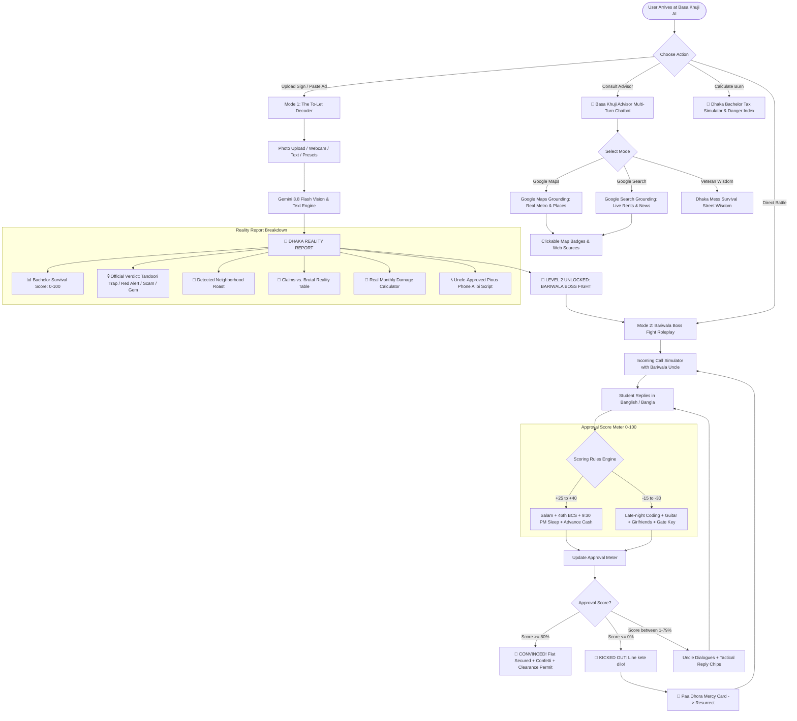

# 🏠 বাসা খুঁজি AI (Basa Khuji AI) 🇧🇩
### *The Ultimate Street-Smart Dhaka Bachelor Mess Decoder & Bariwala Boss Fight Simulator*

[](https://ai.google.dev/)
[](https://react.dev/)
[](https://expressjs.com/)
[](https://developers.google.com/)

---

## 🎯 Project Overview & Persona

**Basa Khuji AI** is built in the persona of a battle-hardened, brutally honest, 10-year Dhaka bachelor mess veteran. Having survived countless house-hunting campaigns across **Mirpur, Mohammadpur, Bosila, Farmgate, Badda, Rampura, and Uttara**, this AI exposes every landlord trap—from the classic *"5 minutes from Metro"* lie (actually a 2.5 km trek through waterlogged alleys) to 7th-floor *"Chader Niche"* summer tandoori ovens, reddish WASA iron water, and 10:15 PM gate curfews.

---

## 📊 System Architecture & State Machine Flowchart



---

## 🚀 Key Features

### 1. 📍 Mode 1: The To-Let Decoder
* **Multi-Format Input**: Upload photos of yellow paper *"টু-লেট"* notice signs, snap photos directly with your camera, or paste Bikroy/Facebook mess listings.
* **5 Authentic Dhaka Presets**:
  * *Mirpur-10 Chader Niche VIP Room* ("5 min to Metro" lie)
  * *Mohammadpur Bosila VIP Sublet* (monsoon boat required)
  * *Farmgate Coaching Hub Sublet* (3 people in 1 tiny room)
  * *Bashundhara R/A Studio* (5,000 BDT Bkash advance token scam)
  * *Badda Notun Bazar Mess* (WASA iron water & 3 AM Titas gas)
* **Visual Reality Dashboard**:
  * **Bachelor Survival Score (0-100)** with authentic 10-block emoji survival meter (`🟩🟩🟩🟥🟥🟥🟥🟥🟥🟥`).
  * **Official Verdict Badges**:
    * `💀 CHADER NICHE TANDOORI TRAP`
    * `🚩 BARIWALA RED ALERT`
    * `🕵️ BKASH ADVANCE SCAM`
    * `💎 RARE DHAKA GEM`
  * **Advertised vs. Actual Monthly Damage**: Auto-calculates unavoidable Dhaka bachelor taxes (rickshaw fare compensations, Khala's mood-swing bonuses, summer fan bills, Darowan gate-opening bribes).
  * **Copyable "Uncle-Approved" Phone Script**: Pious alibi claiming 46th BCS preparation and zero friends in Dhaka.

---

### 2. 🥊 Mode 2: The Bariwala Boss Fight Roleplay
* **Live Telephone Call Simulator**: Retro phone interface with incoming call ring, call timer, and active line monitoring.
* **Dynamic Approval Meter**:
  * **+25 to +40 Approval**: Polite greetings (*Assalamu Alaikum Uncle*), BCS / Govt job prep, 9:30 PM sleep, advance cash rent, flattery.
  * **-15 to -30 Approval**: Late-night freelancing/coding, friends visiting, guitars, complaining about the lift/heat, asking for gate keys.
* **3 Iconic Dhaka Landlord Bosses**:
  * **Alhajj Abdul Kader** *(Mirpur-10, watches CCTV 14 hours a day, keeps gate key under his pillow)*
  * **Engr. Mofizur Rahman** *(Mohammadpur, measures water tank twice daily, charges for table lamps)*
  * **Haji Nurul Islam** *(Badda, requires police clearance and Surah Yaseen recitation)*
* **Tactical Win Arsenal**:
  * 🌟 **BCS 1st Cadre Alibi Card** (+35 Approval)
  * 💵 **3-Month Advance Cash Card** (+30 Approval)
  * 🧓 **Father’s Blessing Card** (+25 Approval)
  * 🧎 **Emergency Paa Dhora (Touch Feet Mercy)** to revive disconnected calls.
  * ⚡ **Instant Win Code** to test victory conditions and view the official stamped **Dhaka Bachelor Tenancy Clearance Permit**.

---

### 3. 🤖 Gemini Multi-Turn Chatbot with Grounding
* **Multi-Turn History**: Scrollable chat thread preserving conversation context.
* **Google Maps Grounding**: Uses `gemini-3.8-flash` with `{ googleMaps: {} }` and Dhaka coordinates (`lat: 23.8103, lng: 90.4125`) to retrieve real-world locations, Metro stations, and nearby food hotels with clickable Google Maps links.
* **Google Search Grounding**: Uses `gemini-3.8-flash` with `{ googleSearch: {} }` to check real-time Dhaka house rent rates, Metro schedules, and WASA advisories with clickable source citations.

---

### 4. 🧮 Dhaka Bachelor Tax Calculator & Danger Index
* **Interactive Sliders**: Customize base rent, floor level (*Chader Niche* heat vs mid-floor), Metro distance rickshaw fares, Khala's mood bonus, late-night gate bribes, and WASA filter replacements.
* **Dhaka Neighborhood Danger Index**: In-depth survival breakdown for *Mirpur, Mohammadpur/Bosila, Farmgate, Badda, Uttara, and Bashundhara R/A*.
* **The 6 Sacred Commandments**: Sacred house-hunting rules (the Pillow Key Test, the 2 PM Ceiling Thermometer, the BCS Punjabi Disguise).

---

### 5. 🔊 Web Audio Dhaka Sound Synthesizer
* **Rickshaw Bell**: Dual-harmonic brass bell (*Tring-Tring!*)
* **Vintage Telephone**: Dual-frequency ring tone (*440Hz + 480Hz*)
* **Uncle Disapproval Buzzer**: Low square-wave throat-clearing buzz
* **Call Disconnect**: Fast off-hook tones (*Line kete dilo!*)
* **Victory Fanfare**: Brass fanfare celebrating landlord approval

---

## 🛠️ Tech Stack & Architecture

* **Frontend**: React 19, TypeScript, TailwindCSS v4, Lucide Icons, Canvas Confetti
* **Backend**: Node.js, Express, tsx
* **AI Engine**: Google Gen AI SDK (`@google/genai`) using `gemini-3.8-flash`
* **Grounding Tools**: `googleMaps` and `googleSearch`
* **Audio Engine**: Web Audio API (Zero external audio file dependencies)

---

## ⚙️ Installation & Local Setup

1. **Clone the repository**:
   ```bash
   git clone <YOUR_GITHUB_REPO_URL>
   cd basa-khuji-ai
   ```

2. **Install dependencies**:
   ```bash
   npm install
   ```

3. **Configure Environment Variables**:
   Create a `.env` file in the root directory:
   ```env
   GEMINI_API_KEY="your-gemini-api-key-here"
   PORT=3000
   ```
   *(Note: The Gemini API key is executed server-side only in `server.ts` and is never exposed to the client bundle.)*

4. **Run the Development Server**:
   ```bash
   npm run dev
   ```
   Open `http://localhost:3000` in your browser.

5. **Build for Production**:
   ```bash
   npm run build
   npm start
   ```

---

## 📜 License & Acknowledgments

Dedicated to every bachelor student and job seeker who has ever survived WASA tap water, 10:00 PM gate curfews, and landlord interrogations in Dhaka city! 🇧🇩
